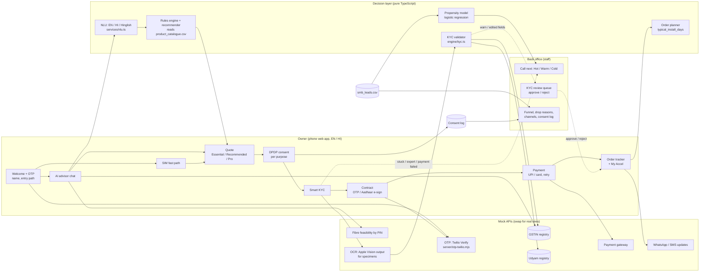

# Solution architecture

**Data flow in one line:** the language layer only *understands* the owner. The rules engine *decides* what can be sold.
KYC checks documents against the application and the registries. Anything a machine can't settle goes to a human
queue, ranked by propensity.

| Component | Prototype | Production swap |
| --- | --- | --- |
| OTP | Mock (any 6 digits) or Twilio Verify via `server/otp-twilio.mjs` | Same server, or the operator's SMS gateway |
| GSTIN / Udyam lookup | CSV-backed mock with the real API shape | GSTN / Udyam APIs via a GSP |
| OCR | Apple Vision text for the 47 specimens | Any OCR API returning lines + boxes |
| E-sign | Mock Aadhaar e-sign, real OTP sign | Licensed ESP (Aadhaar eSign) |
| Payment | Mock UPI / card with forced failure | Payment gateway, UPI intent |
| Storage | Browser localStorage | Orders, leads and consent services with audit logs |
